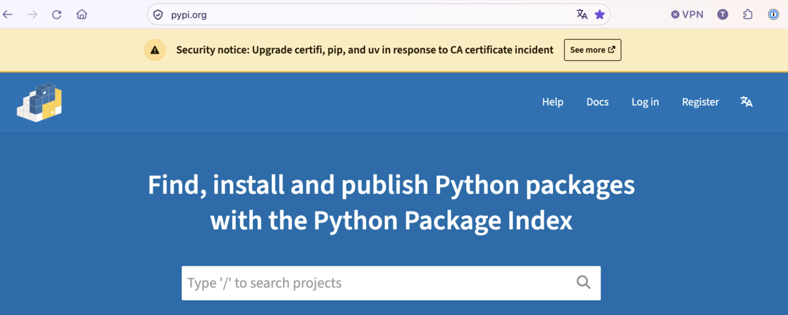

:ogp_title: vs eMudhra
:ogp_event_name: jiyugaoka-any1
:ogp_slide_name: vs-emudhra
:ogp_description: 第1回 自由が丘.any

================================================================================
vs eMudhra🏐
================================================================================

:Event: 第1回 自由が丘.any
:Presented: 2026/11/11 nikkie

.. raw:: html

    

.. 【10秒／累計0:10】
   10月に、ある認証局の事故をきっかけに、普段使っているツールが
   HTTPSの接続先をどう確かめているのか調べました。

*We have a problem here* [#secret-apollo]_
================================================================================

* eMudhra [#emudhra-pronunciation]_ Intermediate CA Compromiseの対応について（Python使い視点）
* https://emudhra.we-have-a-problem.com/ を賢いコーディングエージェントに解説してもらいましょう

.. [#emudhra-pronunciation] Mudhra「ムドラー」 `Jxck氏「eMudhra のインシデントは Web にとって何を意味するのか」 <https://blog.jxck.io/entries/2026-10-25/emudhra.html>`__

.. [#secret-apollo] GrEarl氏「`このセリフはアポロⅩⅢの通信"Houston, we've had a problem"ともつながってる <https://x.com/Iamwonderingif/status/2113999139487060138>`__」

Pythonパッケージインデックス（PyPI）
---------------------------------------------------

.. https://nikkie-ftnext.hatenablog.com/entry/emudhra-we-have-a-problem-python-tools-update-log

noticeに沿ってバージョンアップ
---------------------------------------------------

* `Information for Python users regarding eMudhra / emSign CA certificate security incident <https://discuss.python.org/t/information-for-python-users-regarding-emudhra-emsign-ca-certificate-security-incident/109576>`__
* pipを26.2.2へ
* uvを0.13.4へ

.. 【30秒／累計0:40】
   pipやuvは、パッケージをダウンロードしてインストールするツールです。
   いつも見るサイトにバナーが出ていて、危なそうだったのでまず更新しました。
   それから、そもそも何が起きたのかを調べ始めました。

認証局の事故で、なぜパッケージ管理ツールを更新する？
================================================================================

* ルート証明書バンドルの更新
* 中間認証局eMudhraの証明書からつながる **ルート証明書を削除**

秘密鍵を復元できた🙈
------------------------------------------------------------

* 2026年10月、eMudhraの中間認証局の公開鍵から秘密鍵を復元できると判明（*秘密鍵が4*）
* 攻撃者はeMudhraの秘密鍵で好きに署名（偽装）できる

.. 総当たりで解けちゃったことを示す https://zenn.dev/herumi/articles/search_bad_emudhra_key

.. 【30秒／累計1:40】
   事故の仕組みを調べる手がかりになったのは We Have a Problem の解説です。
   もし攻撃者が通信経路上でその証明書を提示したら、問題の中間認証局を
   まだ信頼するクライアントは、偽のサイトを本物として受け入れかねません。

HTTP **S** (=TLS)：証明書チェーン
------------------------------------------------------------

.. https://tls13-book.doteyaki.dev/06_pki/ca

.. container:: emudhra-chain

    .. mermaid::

        flowchart LR
            Site["サイトの証明書"] --> Intermediate["中間認証局"]
            Intermediate --> Root["信頼済みのルート認証局"]

署名をたどり、手元の信頼済みルートにつながるかを確認

.. 【30秒／累計1:10】
   クライアントは接続先の名前などとあわせて、証明書の署名を確認します。
   サイトの証明書は中間認証局が署名し、その中間認証局にも信頼済みの
   ルートまでの署名のつながりがあります。図の矢印は検証でたどる向きです。
   ここでは間にある認証局を一つに簡略化しています。

対応1 バンドルしたルート証明書から削除
------------------------------------------------------------

* **certifi** 2026.10.19で削除
* pip 26.2.2はcertifi 2026.10.19に依存
* uvも0.13.4でバンドルしている証明書（**webpki-root-certs**）を更新

.. 【60秒／累計2:40】
   certifiは信頼するルート証明書の一覧を配布するPythonパッケージです。
   そこから emSign ECC Root CA - G3 が削除されました。
   pipが持っているコピーやuvの同梱リストにも更新が必要です。
   同じマシンでもツールごとに参照先があるので、バナーに複数の名前が
   並んでいたんですね。これで一件落着かと思ったら、Python本体にも
   修正が入りました。

Python自体もCVE対応
================================================================================

* Python 3.15.2, 3.14.10, 3.13.18, 3.12.16 and 3.11.18
* `gh-160040: Distrust compromised eMudhra intermediate CA keys (CVE-2026-115557) <https://github.com/python/cpython/pull/160042>`__

対応2 検証時に中間認証局の鍵を拒否
------------------------------------------------------------

標準ライブラリ **ssl** でチェーンに問題の公開鍵があれば接続を拒否するように

.. 【30秒／累計3:10】
   チェーンを検証するとき、問題の中間認証局の公開鍵が含まれていれば、
   その時点で接続を拒否するようになりました。信頼するルート一覧の更新が
   環境に届くまでの最後の防御です。なぜここまで必要だったのでしょうか。

macOSとuvの組合せでも安全に
------------------------------------------------------------

* uv (python-build-standalone)で入れたPythonは :file:`/etc/ssl/cert.pem` を参照
* eMudhraの侵害された証明書も含まれる
* 修正前は、標準ライブラリ ``urllib`` で問題のチェーンを使う検証サイトへ接続できてしまった

.. 【45秒／累計4:30】
   当時のmacOSでは、Appleのブロックと、一部のCLIなどが読む
   /etc/ssl/cert.pem のルート一覧は別々でした。私のMacのuv管理の
   Pythonで試すと、3.14.9のurllibは検証サイトに接続できました。
   uvを0.13.6に上げて uv python upgrade を実行し、3.14.10に更新。
   ルート一覧の参照先が同じでも、今度は証明書が拒否されました。
   参照する一覧はPythonの配布元や設定によって変わります。

まとめ🌯 vs eMudhra🏐
================================================================================

* eMudhraの秘密鍵の事故に対応する必要があります⏳
* ルート証明書バンドルは削除したバージョンへ要更新
* CVEとしてPython 3.15.2ではsslモジュールがブロックしたのでmacOS+uvでも安全に

.. 【30秒／累計5:00】
   最初は「何を更新すればいいんだろう」と思っていました。
   調べ終わる頃には「このHTTPS通信は、どの証明書の一覧を使って、
   どこで検証してるんだろう」と考えるようになりました。

.. 別のルートからもたどれた
.. ------------------------------------------------------------

.. .. container:: emudhra-chain

..     .. mermaid::

..         flowchart LR
..             Site["サイトの証明書"] --> Intermediate["中間認証局の鍵"]
..             Intermediate --> RootA["emSign系のルート"]
..             Intermediate --> RootB["別のルート"]

.. **鍵で判定すれば、どちらの経路でも拒否できる**

.. .. 【35秒／累計3:45】
..    クロス署名により、同じ公開鍵を持つ中間認証局に別のルートから
..    たどり着く経路もありました。図は別々の証明書が同じ鍵を使っている点に
..    注目したものです。CPythonの修正は公開鍵で照合するので、別の経路でも
..    拒否できます。
