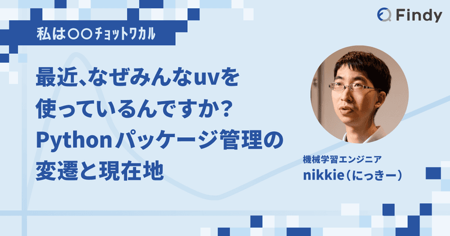

================================================================================
Pythonの環境構築をすることになったあなたへ（2026年版）
================================================================================

Pythonの環境構築をすることになったあなたへ（2026年版）
================================================================================

:Event: Python環境構築を、もう一度考える ~uvに任せていいのはどこまで？~
:Presented: 2026/11/4 nikkie （スペース連打 or 矢印キーでめくります）

お集まりいただきありがとうございます
==================================================

* ゴール：今（2026年）の **Python環境構築がつかめる** （入口までお連れします）
* Pythonの経験がない方も踏まえて前提知識補いながらお伝えします📻

お前、誰よ
============================================================

* nikkie（にっきー）・`Codex Ambassador (Tokyo) <https://nikkie-ftnext.hatenablog.com/entry/announcement-one-of-codex-ambassadors-tokyo>`__・`Devin Ambassador <https://x.com/ftnext/status/2069459222040105357>`__
* 機械学習エンジニア [#uzabase-message]_ ・`Speeda AI Agent <https://www.uzabase.com/jp/info/20250901/>`__ 開発（`A2A <https://jp.ub-speeda.com/news/20260319/>`__・`MCP <https://jp.ub-speeda.com/news/20260701/>`__・`Slackbot <https://jp.ub-speeda.com/news/20260910/>`__ 提供）

.. [#uzabase-message] お詫び申し上げます。`【第二報】NewsPicksのお客様の個人情報漏洩の可能性に関するお詫びとお知らせ <https://corp.newspicks.com/info/20261009>`__

Python歴
------------------------------------------------------------

* 2016〜 ソフトウェアエンジニア
* 2017年11月 Pythonを独学開始（はじめて画像処理）
* 2019〜 仕事でもPython（ユーザベース 機械学習エンジニア）
* LT、`ブログ <https://nikkie-ftnext.hatenablog.com/>`__、PyCon JP 登壇、`小さなOSS <https://github.com/ftnext?tab=repositories>`__

興味あれば後ほどどうぞ
------------------------------------------------------------

興味あれば後ほどどうぞ その2
------------------------------------------------------------

.. raw:: html

    <iframe width="800" height="480" src="https://ftnext.github.io/2026-slides/pyconjp/teach-venv-pip-install-alternatives.html#/1"
        title="Pythonチュートリアル、venv を作って pip install と2026年も教え続けますか？"></iframe>

目次：Pythonの環境構築をすることになったあなたへ
================================================================================

1. Pythonのドキュメントの方法（uv以前）
2. uv以後（uvに任せていいのはどこまで？を考えましょう）
3. 2026年の話題

.. include:: basic.rst.txt

.. include:: uv-way.rst.txt

小まとめ🥟 uvに任せられること
==================================================

* Pythonの管理
* 仮想環境の管理（サードパーティパッケージ管理）

簡単なので任せていっています

.. include:: uv-usecases.rst.txt

お昼明けから試すなら
------------------------------------------------------------

* ``uv tool install`` やinline script metadataから始めることもできます
* :file:`pyproject.toml` のあるプロジェクトなら ``uv sync`` で移行しやすい（ハマったら引き返そう）
* `migrate-to-uv <https://github.com/osprey-oss/migrate-to-uv>`__ というツールもあります。コーディングエージェントも頼れるでしょう

.. include:: topics-2026.rst.txt

One more thing: pnpm
------------------------------------------------------------

* 12でRust実装となり、`12.4 <https://github.com/pnpm/pnpm/releases/tag/v12.4.0>`__ でPythonパッケージ管理もできるようになった [#greedy-pnpm-12]_
* https://pnpm.io/python
* uvの完成度は高いが、言語をまたいだパッケージ管理ツールの登場に注目しています

.. https://nikkie-ftnext.hatenablog.com/entry/pnpm-12-4-ambitious-multi-language-package-manager-support-rust-and-python

.. [#greedy-pnpm-12] 12.4ではRustのパッケージ管理もサポート https://pnpm.io/cargo また、`12.11 <https://github.com/pnpm/pnpm/releases/tag/v12.11.0>`__ でAgent Skillsもインストールできるようになりました https://pnpm.io/agent-skills

.. 未来 PEP 831？

まとめ🌯 Pythonの環境構築をすることになったあなたへ（2026年版）
================================================================================

* Pythonの管理、仮想環境管理、``uv tool install``・inline script metadata、便利です
* あなたはuvにどこまで任せてみますか？

仮想環境の管理が簡単になっている
------------------------------------------------------------

* uvは仮想環境を「`正しい使い方を簡単に、誤った使い方を困難に <https://yoshi389111.github.io/kinokobooks/prog_ja/prog053.htm>`__」した（+爆速 & ワンストップ）
* メッセージ「仮想環境をツールに任せて楽してこーぜ」
* Pythonを深く知りたい方には仮想環境の理解をおすすめします

ご清聴ありがとうございました
------------------------------------------------------------

質問お気軽にどうぞ！

EOF
===
